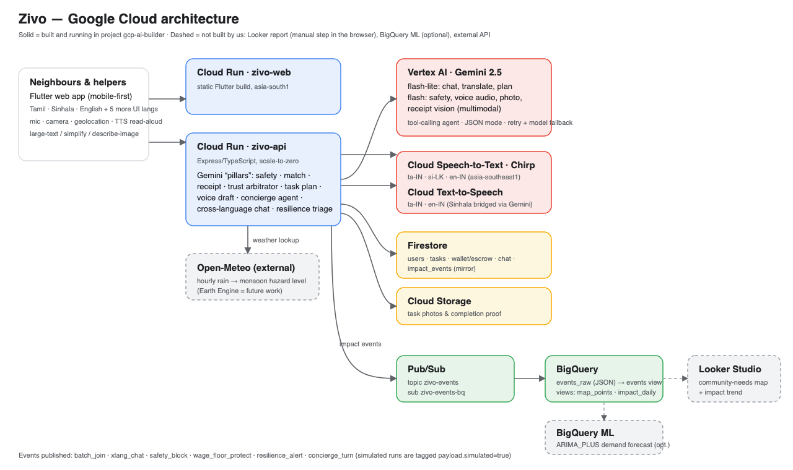

# Zivo — neighbourhood care that speaks your language

An accessible, resilient neighbourhood-care network for people the digital economy skips: **elders, disabled neighbours, and Tamil- / Sinhala-first speakers** in Sri Lanka.
Gemini is the trust-and-safety layer for the informal economy; the marketplace is only the delivery mechanism.
Built for the **Google AI Builder Cup 2026** on Google Cloud (project `gcp-ai-builder`).

| | |
|---|---|
| **Web app** | https://zivo-web-ihp5vjzpsa-el.a.run.app |
| **API** | https://zivo-api-ihp5vjzpsa-el.a.run.app (`/health`) |
| **Architecture** | [docs/ARCHITECTURE.md](docs/ARCHITECTURE.md) |
| **Evaluation** (30 safety · 27 translations · 12 voice clips) | [docs/EVALUATION.md](docs/EVALUATION.md) |
| **Pilot** (clearly labelled *simulated*) | [docs/PILOT_SIMULATED.md](docs/PILOT_SIMULATED.md) |
| **Responsible AI** | [docs/RESPONSIBLE_AI.md](docs/RESPONSIBLE_AI.md) |
| **Demo video script** | [docs/DEMO_SCRIPT.md](docs/DEMO_SCRIPT.md) |
| **Scalability and cost** | [docs/SCALABILITY_COST.md](docs/SCALABILITY_COST.md) |
| **Proposal deck (PDF)** | [docs/deck/Zivo_Proposal.pdf](docs/deck/Zivo_Proposal.pdf) |
| **Inclusive work** (ability-aware jobs, sign-language evaluation) | [docs/INCLUSIVE_WORK.md](docs/INCLUSIVE_WORK.md) |
| **Validation log** | [VALIDATION.md](VALIDATION.md) |



## What is in it

| Feature | Google Cloud | Where |
|---|---|---|
| **Voice concierge agent** — speak Tamil / Sinhala / English, Gemini calls tools (weather, fair price, task draft) and answers in your language | Vertex AI Gemini (tool calling), Cloud STT Chirp, Cloud TTS | `POST /agent/concierge`, `/a11y/transcribe`, `/a11y/tts` |
| **Voice → task + plan in ONE Gemini call** (≈3.7 s, was ≈7.9 s); live progress; model race with hard ceiling | Gemini audio + structured JSON | `/tasks/voice-plan` |
| **Ability-aware work**: blind / deaf / mobility / reading helpers opt in, the client sees an access note and can choose someone else; ability never changes rank or price | Firestore, Gemini | `PATCH /me`, `/tasks/:id/ability-fit`, `/decline-helper` |
| **Zivo Eyes** (describe / read / check a shopping list), **Doorstep Talk** (client speaks → text for a deaf helper), **Say-it** cards, **Easy-read**, adapted job brief | Gemini vision + audio, Cloud TTS | `/a11y/eyes`, `/a11y/doorstep`, `/tasks/:id/adapt-brief` |
| **"Show it. Get help."** photo → task draft | Gemini multimodal | `/tasks/suggest-from-photo` |
| **Vernacular safety** on every post and chat message | lexicon floor + Gemini (`allow/review/block`, fails to *review*, never *allow*) | `/tasks/safety-check`, chat gate |
| **Cross-language chat** (ta ⇄ si ⇄ en) with original one tap away | Gemini | `/tasks/:id/chat` |
| **Constraint match** — Gemini recommends, the client assigns | Gemini | `/tasks/:id/match`, `/assign` |
| **Receipt + completion proof** | Gemini vision | `/tasks/:id/receipt`, `/completion-proof` |
| **Trust arbitrator** — can hold escrow, never move money | Gemini | `/tasks/:id/trust-review` |
| **Escrow, Start / End OTP, cancel refund, dispute freeze** | Firestore | `store.ts` |
| **Monsoon resilience** | Open-Meteo + Gemini triage | `/resilience/status` |
| **Street batching + fair-price floor + CO₂e estimate** | Pub/Sub → BigQuery | `/impact/summary`, `zivo_impact.*` views |
| **Accessibility** — large text, simplify/describe, read-aloud, mic everywhere, 3 languages | Cloud TTS / STT, Gemini | Flutter `a11y_hub.dart` |

Hosting is **Cloud Run** (`zivo-web`, `zivo-api`), data in **Firestore**, photos in **Cloud Storage**, events through **Pub/Sub → BigQuery**.
Not used (and not claimed): Earth Engine, custom Vertex predictive models, Vision AI (photo flow is Gemini multimodal), BigQuery ML.

## Run it

```bash
# API (real Gemini needs gcloud application-default credentials)
cd gcp/api && npm install
GCP_PROJECT_ID=gcp-ai-builder VERTEX_LOCATION=us-central1 USE_MOCK_AI=false npm run dev
# $0 offline mode: USE_MEMORY_STORE=true USE_MOCK_AI=true npm run dev   (canned AI replies, labelled "mock")

# App
flutter pub get
flutter run -d chrome --web-port=7357 --dart-define=GCP_API_BASE_URL=http://localhost:8080
```

`USE_MOCK_AI=true` is for offline development only — the deployed service runs with real Gemini (`/health` reports the model; the smoke test fails if it is `mock`).

## Test

```bash
flutter analyze            # 0 errors (infos/warnings only, see VALIDATION.md)
flutter test               # 13 widget tests
cd gcp/api
npx tsc --noEmit
USE_MEMORY_STORE=true USE_MOCK_AI=true GCP_PROJECT_ID= npx tsx eval/test_money_paths.ts   # escrow / cancel / dispute invariants
GCP_PROJECT_ID=gcp-ai-builder VERTEX_LOCATION=us-central1 USE_MOCK_AI=false npx tsx eval/run_eval.ts   # ~6 min, live Gemini
```

### Rehearse the live demo path (run this before you present)

```bash
node scripts/smoke-demo.mjs        # 12 steps: web, health, login, safety ta/si, concierge, TTS, voice→task, weather, price, impact
node scripts/smoke-lifecycle.mjs   # 11 steps: post → accept → Tamil→Sinhala chat → blocked message → OTP privacy → Start → proof → End → payout → cancel refund
```

`node scripts/smoke-inclusion.mjs` (10 steps) covers ability profile, access note, decline, Eyes, Doorstep, adapted brief, server-side KYC gate and the concierge. `node scripts/latency-voice.mjs` compares the old and new voice paths.

All hit the **live** Cloud Run API and leave a few `smoke.*@zivo.test` rows in Firestore.

## Deploy

```bash
export GCP_PROJECT_ID=gcp-ai-builder GCP_REGION=asia-south1
./scripts/deploy-api.sh    # Cloud Build → Cloud Run zivo-api
./scripts/deploy-web.sh    # flutter build web → Cloud Run zivo-web
```

Further notes: [docs/GCP_DEPLOY.md](docs/GCP_DEPLOY.md), [docs/INFRA.md](docs/INFRA.md), [docs/IMPACT_BIGQUERY.md](docs/IMPACT_BIGQUERY.md), design tokens in [DESIGN_TOKENS.md](DESIGN_TOKENS.md).

## Known limits (read before demoing)

* **Vertex quota**: ~2 concurrent Gemini calls before `429`; retries + model fallback hide it but add seconds. Demo one request at a time and ask for a quota increase first.
* Looker Studio report is **not built** (data views are); the pilot is **simulated**; Sinhala voice-to-task is **unmeasured** and Sinhala read-aloud is bridged via English.
* No human appeal for a Gemini block; no admin tool to resolve a dispute. Full list: [docs/RESPONSIBLE_AI.md §5](docs/RESPONSIBLE_AI.md).
