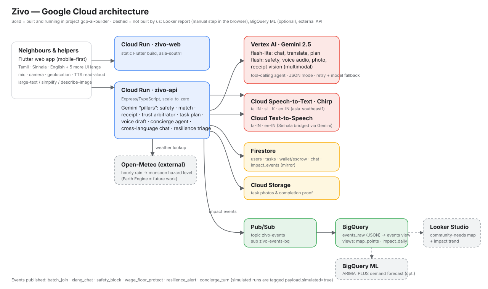

# Zivo — Google Cloud architecture



Project `gcp-ai-builder` · region `asia-south1` (Vertex AI in `us-central1`, Speech in `asia-southeast1`).

## What is actually deployed (verified, not aspirational)

| Layer | Service | Resource | Used for |
|---|---|---|---|
| Hosting | **Cloud Run** | `zivo-web`, `zivo-api` (scale-to-zero) | Flutter web build; Express/TypeScript API |
| AI reasoning | **Vertex AI – Gemini 2.5** | `gemini-2.5-flash-lite` (default), `gemini-2.5-flash` (safety, voice audio, photo/receipt vision) | 8 "pillars": safety, constraint match, receipt, trust arbitrator, task plan, voice draft, concierge agent (tool calling), cross-language chat; Open-Meteo triage |
| Speech | **Cloud Speech-to-Text (Chirp)** | `asia-southeast1` | `ta-IN`, `si-LK`, `en-IN` captions |
| Speech | **Cloud Text-to-Speech** | `ta-IN-Wavenet-A`, `en-IN-Wavenet-A` | read-aloud. Sinhala has no Cloud TTS voice, so it is bridged through Gemini → English and the UI says so |
| Data | **Firestore** | users, tasks, wallet ledger, chat, `impact_events` | system of record |
| Files | **Cloud Storage** | `gcp-ai-builder-zivo-uploads` | task photos, completion proof |
| Events | **Pub/Sub** | topic `zivo-events`, subscription `zivo-events-bq` | every impact event |
| Analytics | **BigQuery** | dataset `zivo_impact` (asia-south1): raw table `events_raw` (Pub/Sub subscription) + views `events`, `map_points`, `impact_daily` | impact + community-needs map data |
| External | Open-Meteo | hourly precipitation | monsoon hazard level (watch/alert/emergency) |

The Pub/Sub → BigQuery path was created with (the first attempt, `--use-table-schema` on a typed table, failed with `invalid_argument` because a nested JSON object cannot be mapped onto typed columns; so raw messages land in `events_raw` and `events` is a typed **view**):

```bash
bq --location=asia-south1 mk -d zivo_impact
bq mk --table zivo_impact.events_raw \
  subscription_name:STRING,message_id:STRING,publish_time:TIMESTAMP,data:JSON,attributes:JSON
bq query --use_legacy_sql=false \
  "GRANT \`roles/bigquery.dataEditor\` ON SCHEMA \`gcp-ai-builder.zivo_impact\` TO 'serviceAccount:service-355844955972@gcp-sa-pubsub.iam.gserviceaccount.com'"
gcloud pubsub subscriptions create zivo-events-bq --topic=zivo-events \
  --bigquery-table=gcp-ai-builder:zivo_impact.events_raw --write-metadata
bq --location=asia-south1 query --use_legacy_sql=false < docs/sql/impact_views.sql   # views events, map_points, impact_daily
```

Two APIs were **not enabled** on the project until this evaluation found it (`texttospeech.googleapis.com`, `speech.googleapis.com`):
before that, read-aloud and Cloud STT silently fell back. They are enabled now and `scripts/smoke-demo.mjs` fails if Cloud TTS is not in `cloud` mode.

## Event model

`publishImpactEvent()` writes Firestore `impact_events/{id}` and publishes the same JSON to `zivo-events`.

| `type` | Emitted by | Payload |
|---|---|---|
| `batch_join` | `POST /batches/join` | `batch_id`, `category`, `lat`,`lon` (rounded to 2 dp ≈ 1 km) |
| `xlang_chat` | `POST /tasks/:id/chat` | `source_lang`, `mode` |
| `safety_block` | chat safety gate | `surface`, `action` |
| `wage_floor_protect` | `POST /tasks/price-quote` | `labor_lkr`, `inflation_index` — **counts every floor quote issued**, not only attempted undercuts |
| `resilience_alert` | `GET /resilience/status` when hazard ≠ calm | `hazard`, `precip_mm_next_24h`, `lat`,`lon` (2 dp) |
| `concierge_turn` | `POST /agent/concierge` | `lang`, `mode`, `allowed` |

Requests sent with header `x-zivo-simulated: 1` tag every event they cause with `payload.simulated = true`, so simulated and real data never mix
(`GET /impact/summary?source=real|simulated|all`).

> Known gap: `safety_block` is only emitted from the chat gate. Blocks at task creation are returned to the user but not counted yet.

## Looker Studio community-needs map — honest status

* **Built:** the data. `zivo_impact.map_points` has one row per geo-tagged event with `lat`, `lon`, `geo` (GEOGRAPHY), `hazard`, `category`, `simulated`;
  `zivo_impact.impact_daily` rolls up trips saved, CO₂e, blocks, translated messages.
* **Not built by me:** the Looker Studio *report itself*. Looker Studio reports can only be authored in the browser under your Google account.
  It takes ~3 minutes:
  1. <https://lookerstudio.google.com/> → **Create → Report → BigQuery** → project `gcp-ai-builder` → `zivo_impact` → `map_points`.
  2. Add a **Google Maps → Bubble map** chart; Location = `lat_lon` (set type *Geo → Latitude, Longitude*), Bubble size = `precip_mm_24h`, colour = `hazard`.
  3. Add `impact_daily` as a second data source: scorecards for `trips_saved_est`, `co2e_kg_est`, `xlang_messages`, `safety_blocks`, plus a time series by `day`.
  4. Add a filter control on `simulated` so the audience can see real vs simulated.
  5. Share → *Anyone with the link can view*.
* Do not call it "live in Looker" in the pitch until step 5 is done. Say "BigQuery tables and views are live; Looker report built on top".

## Not used (and not claimed)

Earth Engine, Vertex AI custom/predictive models, Vision AI (the "Show it. Get help." photo flow uses Gemini multimodal), BigQuery ML (the ARIMA example in
`IMPACT_BIGQUERY.md` is a recipe, not run).
