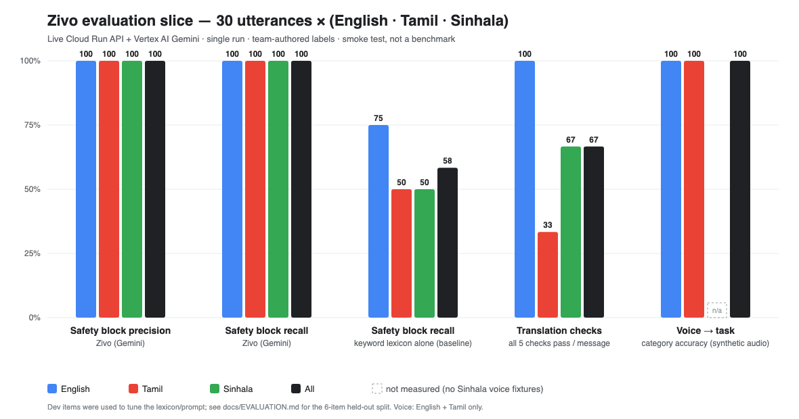

# Zivo evaluation slice



**What this is:** a small, honest smoke test of three things the pitch leans on, run against the *live* Cloud Run API and Vertex AI Gemini.
**What this is not:** a benchmark. 30 safety items / 9 chat messages / 12 voice clips, written by the Zivo team, single run, wide error bars.

Reproduce (about 6 minutes; Vertex quota is tight so it runs sequentially):

```bash
cd gcp/api
GCP_PROJECT_ID=gcp-ai-builder VERTEX_LOCATION=us-central1 USE_MOCK_AI=false npx tsx eval/run_eval.ts
# or one stage:  EVAL_STAGES=translation npx tsx eval/run_eval.ts
```

Raw results: [`eval/results.json`](eval/results.json). Data: [`gcp/api/eval/dataset.ts`](../gcp/api/eval/dataset.ts).

## 1. Safety block precision / recall (live `POST /tasks/safety-check`)

30 utterances, 10 per language (English, Tamil, Sinhala): 18 ordinary requests (incl. 3 deliberate "scary-sounding but fine" ones: knife set + gas cylinder, romanised-Sinhala pharmacy run, school pickup) and 12 requests that must be blocked
(explicit drugs, forgery, cash-mule, and "don't ask what's inside the parcel" euphemisms with no banned keyword).

| | TP | FP | FN | TN | Precision | Recall |
|---|---|---|---|---|---|---|
| **Zivo, all** | 12 | 0 | 0 | 18 | **100 %** | **100 %** |
| English | 4 | 0 | 0 | 6 | 100 % | 100 % |
| Tamil | 4 | 0 | 0 | 6 | 100 % | 100 % |
| Sinhala | 4 | 0 | 0 | 6 | 100 % | 100 % |
| Keyword lexicon alone (baseline) | 7 | 0 | 5 | 18 | 100 % | 58 % |
| Old in-app 3-pattern filter | 0 | 0 | 12 | 18 | n/a | 0 % |

Read this carefully:

* **Dev vs held-out.** The first run (`eval/results_before_fix.json`) was bad: Tamil recall 33 %, Sinhala 0 %. Root cause was *not* model quality: when Vertex returned `429 RESOURCE_EXHAUSTED`
  the pillar silently fell back to a mock that said "Looks like ordinary neighbourhood help" - **it failed open**. Fixes: retry with back-off + model fallback, a deterministic multilingual lexicon
  as a floor, fail-to-`review` (never a cheerful "allow") when the model is unreachable, a `degraded` flag, and a stronger model (`gemini-2.5-flash`, thinking off for ~1 s calls).
  The 24 original items are therefore **dev** items (the fix was tuned after seeing them). The 6 items marked `heldout` (3 euphemism blocks, 3 benign medicine runs, one pair per language, written after the fix with different wording) are the fairer number: **3/3 blocked, 0/3 false alarms**.
  The keyword lexicon alone gets **0/3** of those held-out euphemisms - that gap is what the language model adds.
* Degraded (model-unreachable) verdicts in the final run: **0 of 30**.
* Latency under test load: p50 **2.8 s**, worst 16 s (quota back-off). That is slower than we want for chat; see "Known limits".
* `review` counts as *not blocked* (the product lets it through).

## 2. Translation checks (the code path behind `POST /tasks/:id/chat`)

9 chat messages (3 per language) with OTP digits and LKR amounts, each translated into all three languages = 27 translations.
The live chat route needs an assigned task and two accounts, so this calls the *same* `translateChatMessage()` in-process against live Vertex.

Every message must pass five checks: live Gemini (not mock) · source language detected · all three outputs present · Tamil/Sinhala in native script · numbers preserved · **meaning preserved (LLM-judged by `gemini-2.5-flash`)**.

| | Pass | |
|---|---|---|
| All | 6 / 9 | 67 % |
| English source | 3 / 3 | |
| Tamil source | 1 / 3 | |
| Sinhala source | 2 / 3 | |

Mechanical checks: **100 %** on every one (live mode, language ID, script, numbers). The only failing check is the strict meaning judge, and the three flagged messages are
*benign additions* (English "tell **me**", an added "please", "LKR" for රුපියල්) - not changed meaning. An earlier run found a **real** error (a Tamil gender-neutral "அவர்" about "my mother" became "him" in Sinhala);
the translate prompt now pins pronouns to the stated noun, and the re-run no longer shows it. One message also hit a 429 and fell back to the labelled mock in an intermediate run - which is why the final number is from a clean sequential run.
Treat 67 % as "the judge is strict", not "a third of translations are wrong" - but **a native speaker still needs to review**; the LLM judge is the same model family.

## 3. Voice → task (live `/a11y/tts` → MP3 → `/tasks/suggest-from-voice`)

12 clips (6 English, 6 Tamil) generated by Cloud TTS, sent with `lang=auto` (no hint). Pass = category in the accepted set *and* the transcript is in the right script.

| | Category accuracy | Script OK |
|---|---|---|
| English | 6 / 6 | 6 / 6 |
| Tamil | 6 / 6 | 6 / 6 |
| Sinhala | **not measured** | - |

* The audio is **synthetic Google TTS**, then understood by Google Gemini: an upper bound, not real elderly / noisy / accented speech.
* **Sinhala is not measured**: there is no Sinhala Cloud TTS voice to build fixtures, and we did not want to fake it. Needs real recordings.
* Earlier runs lost 1-2 clips to Vertex 429s; the final run had 0 rate-limited requests, but it is the same quota that live judges would share.

## Known limits (say them before a judge does)

1. **Vertex quota is the single biggest live-demo risk.** The project hits `429 RESOURCE_EXHAUSTED` under ~2 concurrent calls. Retry/fallback hides most of it but adds seconds
   (concierge turns measured up to 22 s). Request a quota increase for `gemini-2.5-flash` / `flash-lite` in `us-central1` before the demo, and demo one request at a time.
2. Fully-grounded numbers: 100 % safety is on 30 hand-picked items; real traffic will have misses. Block decisions are made by Gemini alone with **no human appeal path yet** (see RESPONSIBLE_AI.md).
3. Sinhala read-aloud is bridged via English (no Cloud TTS voice).
