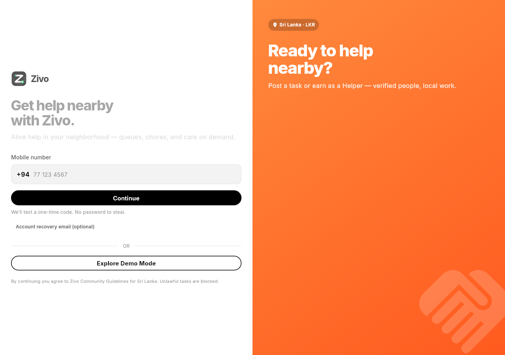
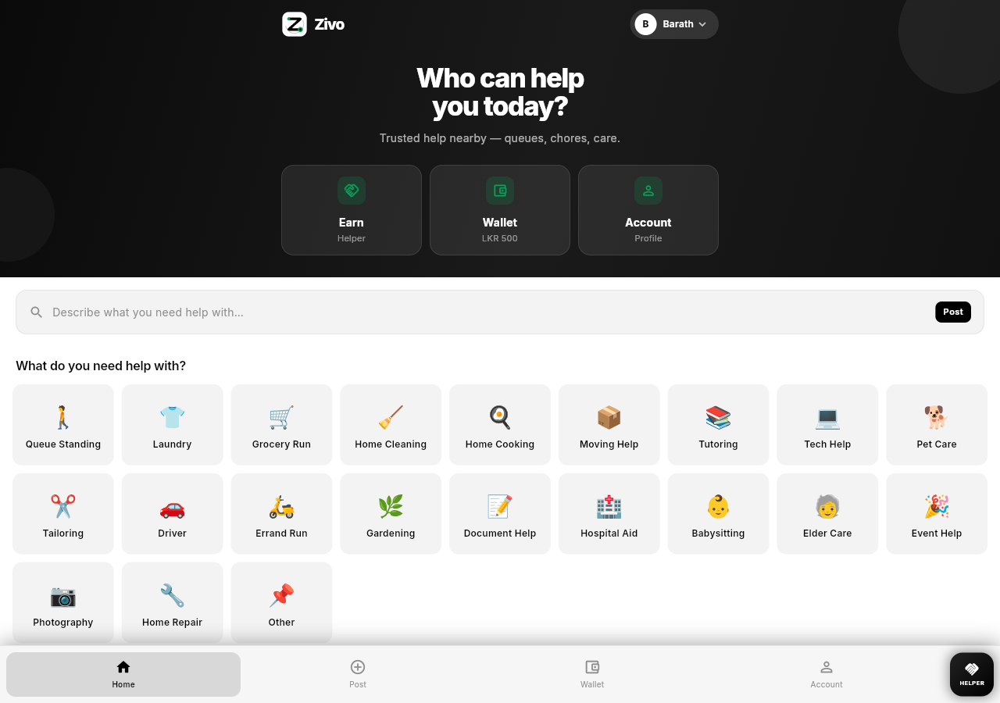
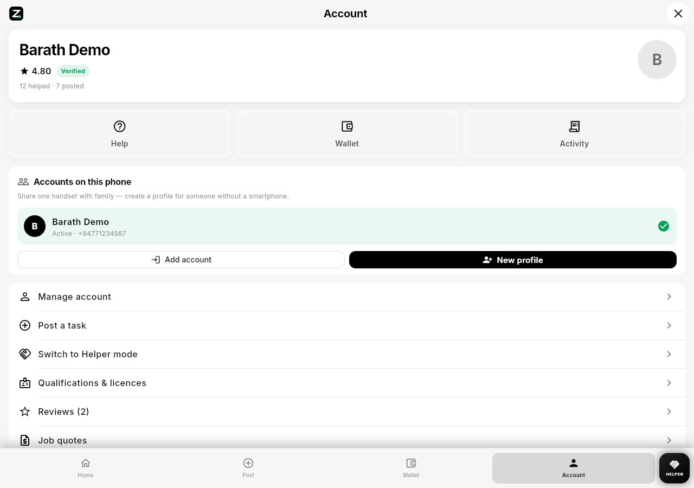
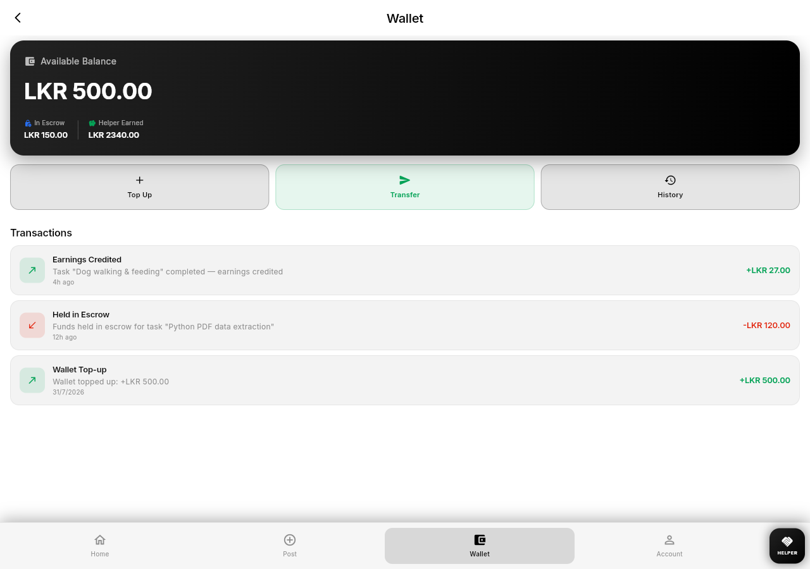

# Zivo — Investor Proposal

**Trusted help, nearby.** Peer-to-demand micro-tasks with identity, escrow, and policy — starting in Sri Lanka, designed to export.

> Live demo: `http://localhost:7357` · Full interactive deck: open canvas **Zivo Investor Proposal** in Cursor  
> Production checklist: [PRODUCTION.md](./PRODUCTION.md)

---

## 1. Vision

Zivo is the neighborhood operating system for short, trusted human help — queues, chores, care, tutoring, errands — with **Uber-grade UX** and a **compliance-first trust stack** missing from generic gig apps.

## 2. Unique value (why we win)

| Moat | Proof in product |
|------|------------------|
| Local identity KYC | NIC + selfie + ops review; helper mode gated on verified |
| Money safety | LKR wallet + escrow hold/release + ledger |
| Illegal-job filter | Policy engine + SQL gate |
| Skills gate | Qualifications for driving / tutoring / care |
| Inclusion | Multi-account on one phone (family without smartphones) |
| Geo | PostGIS nearby dispatch (5 km), not S2 |

**Worldwide path:** beachhead SL → replicate ID + dial + currency packs via `AppConfig` dart-defines (same core).

## 3. Product screenshots (live build)

### Login & brand

### Home — centered Earn / Wallet / Account

### Categories

### Account + multi-account

### Wallet / escrow

## 4. Business model

- **Take rate:** 10% platform fee on escrow release (configurable).
- Dual-sided network: every user can Client or Helper.
- Expansion: city density → national → multi-market compliance packs.

## 5. Traction readiness (honest)

This version is **investor-demo ready**. Public production needs SMS OTP, real KYC vendor, real GPS, payment gateway — see [PRODUCTION.md](./PRODUCTION.md). Demo mode stays for pitches (`ENABLE_DEMO_MODE=true` in debug).

## 6. The ask (illustrative)

90-day milestone: production Android + web, live top-up, KYC SLA, Colombo/Negombo completed-job KPIs.

| Use of funds | Share |
|--------------|-------|
| Trust & payments | 40% |
| Growth / ops | 35% |
| Product (i18n, polish) | 25% |

---

*Zivo · Aug 2026 · Confidential*
